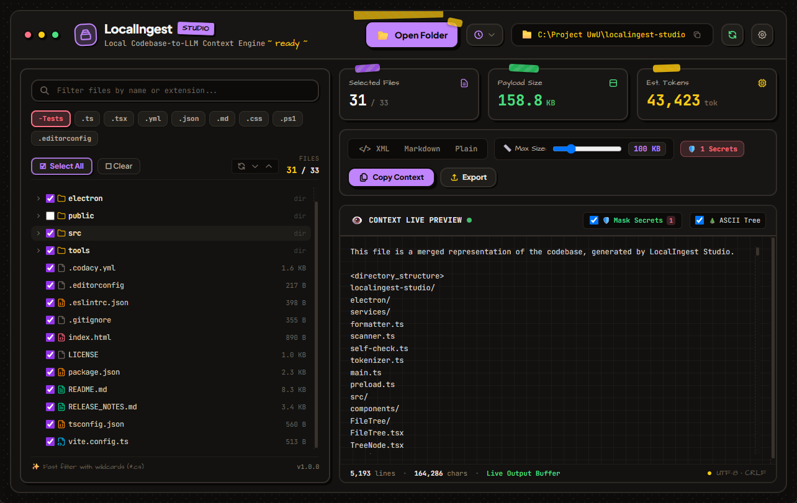

<div align="center">
  
  <h1>LocalIngest Studio</h1>
  <p>Tactile Local Codebase-to-LLM Context Engine with Interactive 3-State File Tree & Secret Redaction</p>

  <p>
    
    
    
    
    
    
  </p>

  <br />
  
  <br />
</div>

---

## Overview

LocalIngest Studio is a high-speed desktop application designed to scan, filter, and compile local codebases into structured prompts optimized for Large Language Models including **Google Gemini**, **Anthropic Claude 3.5**, and **OpenAI GPT-4o**.

Combining the interactive ergonomics of desktop software with the robust extraction pipeline of **GitIngest** and **Repomix**, the application operates entirely offline on local hardware, ensuring complete source privacy.

---

## Key Features

- **Multi-Platform Standalone Binaries**: Distributed as clean, self-contained single-file executables without runtime folder clutter—portable `.exe` on Windows and `.AppImage` on Linux.
- **Craft Cardboard & Neon Highlighter Aesthetic**: Tactile dark kraft base (`#0e0d0c`) with brutalist zero-blur marker drop shadows, striped washi tape pins, and hand-sketched organic contours.
- **Interactive 3-State File Tree**: Recursive directory tree with tri-state checkbox tracking (`checked`, `unchecked`, `indeterminate`). Selecting a parent directory automatically synchronizes all nested children.
- **Git-Aware Selection**: One-click selection to isolate and export only modified, unstaged, or untracked files discovered through local `git status --porcelain`.
- **Zero-Leak Secret Redaction**: Real-time heuristic credential detector that identifies and masks sensitive API keys, JWTs, private keys, and environment tokens with `[REDACTED_SECRET: TYPE]` placeholders before clipboard transfer.
- **GitIngest-Style Discrete Threshold Slider**: Stepped threshold filtering (10 KB, 20 KB, 50 KB, 100 KB, 200 KB, 500 KB, 1 MB, 2 MB, 5 MB, 10 MB, 20 MB, 50 MB, 100 MB, and Unlimited) with visual sticker warning tags on oversized files.
- **Real-Time Token Calculation**: Native offline token counting using `js-tiktoken` (`cl100k_base` / `o200k_base`) with dynamic threshold warnings.
- **Instant Codebase Rescan & Refresh**: One-click tactile buttons and global `F5` / `Ctrl+R` shortcuts that flush memory cache to re-sync external disk modifications and unstaged Git files immediately.
- **Multi-Format Output Pipeline**: Export cleanly structured context in Repomix-style XML, GitHub Flavored Markdown, or Plain Text with optional ASCII directory visualization.

---

## Output Formats

### 1. XML (Repomix Specification)
Encapsulates instructions, directory tree, and code contents into structured XML tags. Ideal for Anthropic Claude and OpenAI reasoning models:

```xml
<context>
  <directory_structure>
    📁 src/
    └── index.ts
  </directory_structure>
  <files>
    <file path="src/index.ts">
      // file contents
    </file>
  </files>
</context>
```

### 2. Markdown
Standard Markdown document formatting each file with language-specific syntax fences:

````markdown
# Project Context

## src/index.ts
```typescript
// file contents
```
````

### 3. Plain Text (GitIngest Specification)
Line-delimited, lightweight plain text format with clear file path separators:

```text
================================================
File: src/index.ts
================================================
// file contents
```

---

## Project Structure

```text
LocalIngest-Studio/
├── .github/
│   └── workflows/
│       ├── checks.yml                 — Automated CI & engine test suite
│       └── release.yml                — GitHub Actions standalone compiler & release publisher
├── electron/
│   ├── main.ts                        — Native window lifecycle & IPC bridge handlers
│   ├── preload.ts                     — Context isolation bridge
│   └── services/
│       ├── scanner.ts                 — Recursive directory crawler with .gitignore & binary filter
│       ├── tokenizer.ts               — js-tiktoken BPE token estimation engine
│       ├── formatter.ts               — Multi-format context builder (XML, MD, Plain)
│       └── self-check.ts              — Runnable assert-based test runner
├── src/
│   ├── components/
│   │   ├── FileTree/
│   │   │   ├── FileTree.tsx           — Search, extension pills, & selection strip
│   │   │   ├── TreeNode.tsx           — 3-state checkbox node renderer with warning badges
│   │   │   └── useFileTree.ts         — Recursive tri-state tree state management hook
│   │   ├── HeaderBar.tsx              — Window controls, brand icon, and path chip
│   │   ├── StatsBar.tsx               — Pinned index cards, format switcher, and felt slider
│   │   ├── PreviewPanel.tsx           — Graph paper notebook preview with secret toggle
│   │   └── SettingsModal.tsx          — Custom ignore patterns configuration dialog
│   ├── services/
│   │   └── secretDetector.ts          — Regex heuristic credentials & token scanner
│   ├── types/
│   │   └── index.ts                   — Unified TypeScript interface definitions
│   ├── App.tsx                        — Two-column grid workspace shell
│   ├── index.css                      — Craft Cardboard & Neon Highlighter design system
│   └── main.tsx                       — React DOM entry point
├── tools/
│   └── build_all.ps1                  — 1-click standalone portable packager & cleaner
├── .codacy.yml                        — Codacy static analysis configuration & build exclusions
├── .editorconfig                      — Cross-platform whitespace, indentation, & line-ending spec
├── .eslintrc.json                     — ESLint quality profile for static analysis
├── .gitignore                         — Build output, dependency, and release exclusions
├── LICENSE                            — MIT open-source license
├── package.json                       — Node dependencies, scripts, and electron-builder spec
├── RELEASE_NOTES.md                   — User-facing changelog and release descriptions
├── tsconfig.json                      — TypeScript compiler configuration
└── vite.config.ts                     — Vite bundling configuration with Electron plugin
```

---

## Requirements

- **Operating System:**
  - **Windows:** Windows 10 or Windows 11 (64-bit)
  - **Linux:** Any modern Linux distribution (Ubuntu 20.04+, Debian 11+, Fedora 36+, Arch Linux) via standalone `.AppImage`
- **Node.js (For building from source):** Node.js 20+ and npm 10+

---

## Building from Source

To clone the repository and launch in development mode:

```bash
git clone https://github.com/Izumii99/LocalIngest-Studio.git
cd LocalIngest-Studio
npm install
npm run dev
```

---

## Running Tests

To execute the offline engine test suite (token verification, ASCII tree builder, and secret redaction):

```bash
npm run test:engine
```

---

## Packaging Standalone Binaries

### Windows (Local Build)
To produce clean, single-file compact executables without intermediate folder clutter:

```powershell
.\tools\build_all.ps1
```

The resulting standalone executable will be located at:
`release/LocalIngest-Studio-Portable-v1.0.0.exe`

### Linux (.AppImage)
On a Linux build machine or via GitHub Actions CI/CD:

```bash
npm run package:linux
```

To run the resulting `.AppImage` on any Linux distribution:
```bash
chmod +x release/LocalIngest-Studio-Linux-v1.0.0.AppImage
./release/LocalIngest-Studio-Linux-v1.0.0.AppImage
```

---

## License

This project is licensed under the [MIT License](LICENSE) — Copyright (c) 2026 Izumii99.
